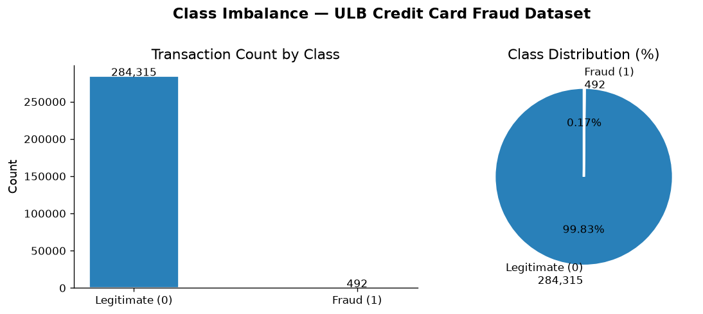
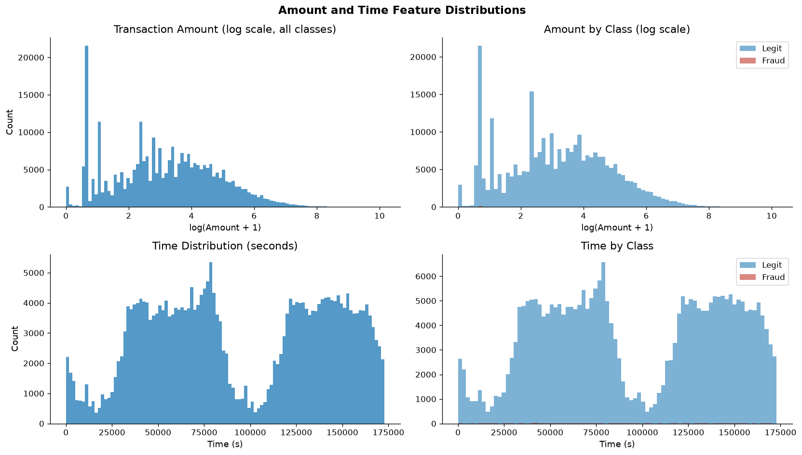
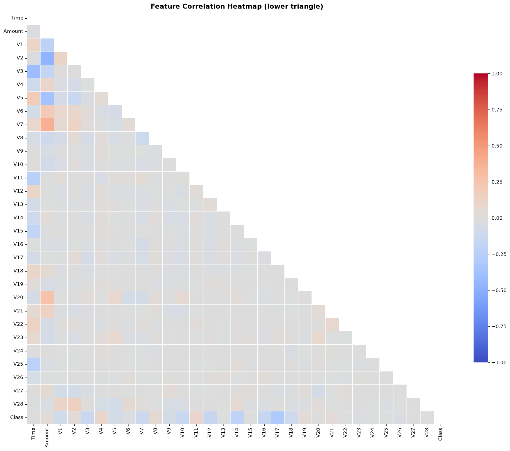
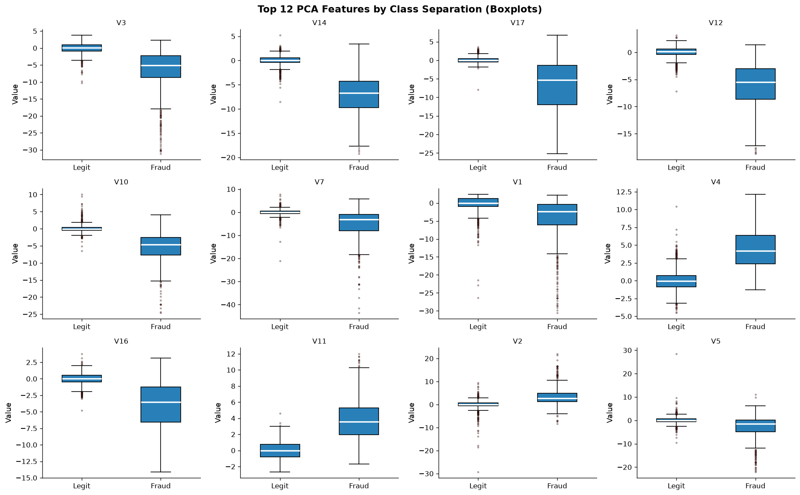
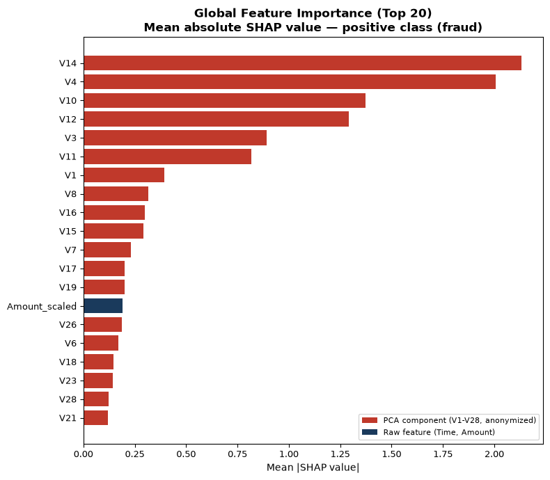

# FraudGuard AI ? College Project Report

**Course**: Machine Learning / Artificial Intelligence
**Project**: Credit Card Fraud Detection with Explainable AI
**Dataset**: ULB Credit Card Fraud Detection (Kaggle)

---

## 1. Introduction

### 1.1 Problem Statement
Credit card fraud causes significant financial loss worldwide. Detecting fraudulent transactions automatically is a supervised binary classification problem where the positive class (fraud) is extremely rare ? approximately 0.17% of transactions.

### 1.2 Objectives
1. Build a reproducible ML pipeline using the ULB Credit Card Fraud dataset.
2. Implement and fairly compare three classifiers: Logistic Regression, Random Forest, and XGBoost.
3. Apply appropriate techniques for handling severe class imbalance.
4. Tune the best-performing model with cross-validation.
5. Implement Explainable AI (SHAP) to interpret model decisions.
6. Deploy a professional Streamlit dashboard for interactive exploration.

### 1.3 Report Structure
Brief overview of each subsequent section.

---

## 2. Dataset

### 2.1 Source and Description
- **Source**: Machine Learning Group, Universit? Libre de Bruxelles (ULB). Available on Kaggle.
- **Citation**: Dal Pozzolo et al., IEEE SSCI 2015.
- **Rows**: 284,807 transactions
- **Columns**: 31 (Time, Amount, V1?V28, Class)
- **Time period**: Two consecutive days in September 2013 (European cardholders)

### 2.2 Feature Description
| Feature | Description |
|---------|-------------|
| Time | Seconds since first transaction |
| Amount | Transaction amount (EUR) |
| V1?V28 | PCA-transformed features (anonymized; original semantics confidential) |
| Class | Binary label: 0 = legitimate, 1 = fraud |

### 2.3 Class Distribution
- Fraud: 492 (0.172%)
- Legitimate: 284,315 (99.828%)
- Imbalance ratio: approximately 1:578

---

## 3. Exploratory Data Analysis

### 3.1 Data Quality
- Missing values: None detected.
- Duplicate rows: 1,081 (removed before model splitting).
- All features are numeric; no categorical encoding required.

### 3.2 Class Imbalance


The dataset contains 492 fraud cases (0.1727%) and 284,315 legitimate
transactions (99.8273%), an imbalance of about 1 fraud per 578 legitimate
transactions.
The extreme imbalance means standard accuracy is a misleading metric. Precision-Recall AUC (Average Precision) is the primary evaluation criterion.

### 3.3 Feature Distributions


- Transaction amounts are right-skewed. Legitimate transactions have a mean
  amount of ?88.29 and median of ?22.00; fraud transactions have a mean of
  ?122.21 and median of ?9.25.
- The time distribution is shown in seconds from the first transaction. The
  dataset spans 172,792 seconds (approximately two days); no causal or
  calendar-time interpretation is inferred.

### 3.4 Correlation Analysis


The largest absolute Pearson correlations with `Class` are V17 (-0.3135),
V14 (-0.2934), V12 (-0.2507), and V10 (-0.2070). These are associations,
not causal effects.

### 3.5 Feature-vs-Target Analysis


Boxplots of the top 12 PCA features by mean absolute difference between classes reveal which anonymized components contribute most to separating fraud from legitimate transactions.

---

## 4. Preprocessing

### 4.1 Data Splits
Reproducible stratified splits (seed=42):
- Training: 70% (198,608 rows)
- Validation: 15% (42,559 rows)
- Test: 15% (42,559 rows)

The test set is used exactly once for final evaluation after all modelling decisions are frozen.

### 4.2 Feature Scaling
A `ColumnTransformer` applies `StandardScaler` to `Time` and `Amount`. V1?V28 are passed through unchanged (they are approximately standardized by the PCA transformation).

**No-Leakage guarantee**: The scaler is fitted exclusively on training data and applied to validation/test data using training statistics.

### 4.3 Class Imbalance Handling
- Logistic Regression: `class_weight='balanced'`
- Random Forest: `class_weight='balanced_subsample'`
- XGBoost: `scale_pos_weight = n_negatives / n_positives` (computed from training set only)

SMOTE was considered but not included in the primary pipeline to avoid leakage risk. It would require integration inside cross-validation folds via `imblearn.pipeline.Pipeline`.

---

## 5. Model Development

### 5.1 Models Implemented

| Model | Key Configuration |
|-------|-------------------|
| Logistic Regression | L2 regularization, lbfgs solver, class_weight='balanced' |
| Random Forest | 200 trees, class_weight='balanced_subsample' |
| XGBoost | 300 estimators, scale_pos_weight, eval_metric=aucpr |

### 5.2 Pipeline Architecture
Each model uses an sklearn `Pipeline`:
```
ColumnTransformer (scale Time/Amount, passthrough V1-V28)
    ? Classifier
```

This ensures preprocessing and classification are applied consistently and leakage-free.

---

## 6. Experimental Results

### 6.1 Baseline Validation Metrics (threshold=0.5)

| Model | Accuracy | Precision | Recall | F1 | ROC-AUC | Average Precision |
|-------|---------:|----------:|-------:|---:|--------:|------------------:|
| Logistic Regression | 0.9722 | 0.0508 | 0.8873 | 0.0961 | 0.9718 | 0.6970 |
| Random Forest | 0.9995 | 1.0000 | 0.7042 | 0.8264 | 0.9405 | 0.8497 |
| XGBoost | 0.9996 | 1.0000 | 0.7465 | 0.8548 | 0.9796 | 0.8539 |

### 6.2 Champion Selection
XGBoost achieved the highest baseline validation Average Precision (0.8539),
compared with 0.8497 for Random Forest and 0.6970 for Logistic Regression.
XGBoost was therefore selected as the champion.

### 6.3 Test Set Metrics

| Model (threshold=0.5) | Accuracy | Precision | Recall | F1 | ROC-AUC | Average Precision |
|-----------------------|---------:|----------:|-------:|---:|--------:|------------------:|
| Logistic Regression | 0.9744 | 0.0551 | 0.8873 | 0.1038 | 0.9609 | 0.6810 |
| Random Forest | 0.9995 | 0.9298 | 0.7465 | 0.8281 | 0.9540 | 0.8049 |
| XGBoost | 0.9995 | 0.8750 | 0.7887 | 0.8296 | 0.9696 | 0.8043 |

The validation-selected XGBoost champion, evaluated at its validation-optimized
threshold (0.8773), achieved test accuracy 0.9995, precision 0.9310, recall
0.7606, F1 0.8372, ROC-AUC 0.9696, and Average Precision 0.8043. It produced
4 false positives and 17 false negatives on 42,559 test transactions (71 fraud).

All metrics reported here were computed on the held-out test set after all modelling decisions (champion selection, threshold) were frozen.

---

## 7. Hyperparameter Tuning

### 7.1 Method
`RandomizedSearchCV` with `StratifiedKFold` (k=5) was applied to the champion model on training data only.

- Iterations: 30
- Scoring: Average Precision
- Search space: [see Table in scripts/train.py]

### 7.2 Results
| Model | Baseline Val AP | Tuned Val AP | Change |
|-------|----------------:|-------------:|-------:|
| XGBoost | 0.8539 | 0.8441 | -0.0097 |


Because tuning did not improve validation Average Precision, the training
pipeline retained the baseline XGBoost model as the champion. The threshold was
selected on validation predictions from that retained model.

### 7.3 Decision Threshold
The decision threshold was selected by maximising F1 on the **validation set**
(not the test set). Optimal threshold: **0.8773**.

---

## 8. Explainable AI

### 8.1 SHAP Overview
SHAP (SHapley Additive exPlanations) provides theoretically grounded feature attributions consistent with game theory. TreeExplainer (exact) is used for tree-based models; LinearExplainer for Logistic Regression.

### 8.2 Global Feature Importance


Mean absolute SHAP values indicate which features most influence the model globally across many predictions.

The largest mean absolute SHAP values in the validation sample were V14
(2.1306), V4 (2.0078), V10 (1.3735), and V12 (1.2905). This describes the
champion model's feature attributions; it does not provide causal explanations.

### 8.3 Local Explanations
The Fraud Prediction and Explainable AI dashboard pages generate a SHAP
waterfall plot interactively for the selected demo transaction. Waterfall
plots show how each feature pushed that transaction's model score above or
below the baseline.

### 8.4 Disclaimer
V1?V28 are anonymized PCA components. Their original meanings are confidential and are not inferred or invented in this project. Feature names are used as-is.

---

## 9. Deployment

### 9.1 Streamlit Dashboard
A five-page interactive dashboard provides:
1. **Overview**: Dataset KPIs and EDA charts.
2. **Fraud Prediction**: Score individual transactions with SHAP explanation.
3. **Model Comparison**: Full evaluation metrics, curves, and comparison.
4. **Explainable AI**: Global importance and per-transaction waterfall.
5. **Transaction Monitor**: Batch scoring, filtering, and CSV export.

The dashboard was smoke-tested locally. Each page loaded; the demo
transaction was scored and the local SHAP explanation rendered.

### 9.2 Artifact Management
Trained models are saved as `.joblib` files. The app loads artifacts at startup and never retrains. The full 150 MB dataset is not required for deployment.

### 9.3 Running the Application
```bash
streamlit run app.py
```

---

## 10. Conclusion

### 10.1 Summary
[Summarise results: which model won, key metrics achieved, what the SHAP analysis revealed about fraud patterns in the anonymized features.]

### 10.2 Limitations
1. V1?V28 are anonymized; full interpretability of raw transaction features is not possible.
2. The dataset is from 2013; fraud patterns evolve over time.
3. Risk scores are model outputs, not calibrated probabilities.
4. No temporal cross-validation (the dataset spans two days).

### 10.3 Future Work
- Time-series aware cross-validation
- Probability calibration (Platt scaling / isotonic regression)
- Online learning for concept drift adaptation
- Ensemble stacking of the three models
- Integration with a real-time transaction stream

---

## 11. References

1. Dal Pozzolo, A., Caelen, O., Johnson, R. A., & Bontempi, G. (2015). *Calibrating Probability with Undersampling for Unbalanced Classification.* IEEE SSCI. https://doi.org/10.1109/SSCI.2015.33

2. Lundberg, S. M., & Lee, S.-I. (2017). *A Unified Approach to Interpreting Model Predictions.* NeurIPS 2017. https://arxiv.org/abs/1705.07874

3. Chen, T., & Guestrin, C. (2016). *XGBoost: A Scalable Tree Boosting System.* KDD 2016. https://arxiv.org/abs/1603.02754

4. Pedregosa, F., et al. (2011). *Scikit-learn: Machine Learning in Python.* JMLR, 12, 2825?2830.

5. Chawla, N. V., Bowyer, K. W., Hall, L. O., & Kegelmeyer, W. P. (2002). *SMOTE: Synthetic Minority Over-sampling Technique.* JAIR, 16, 321?357.

6. Saito, T., & Rehmsmeier, M. (2015). *The Precision-Recall Plot Is More Informative than the ROC Plot When Evaluating Binary Classifiers on Imbalanced Datasets.* PLOS ONE.
